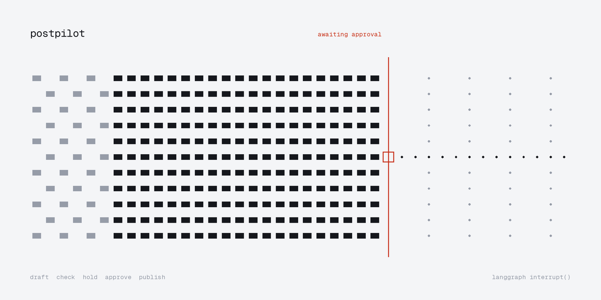
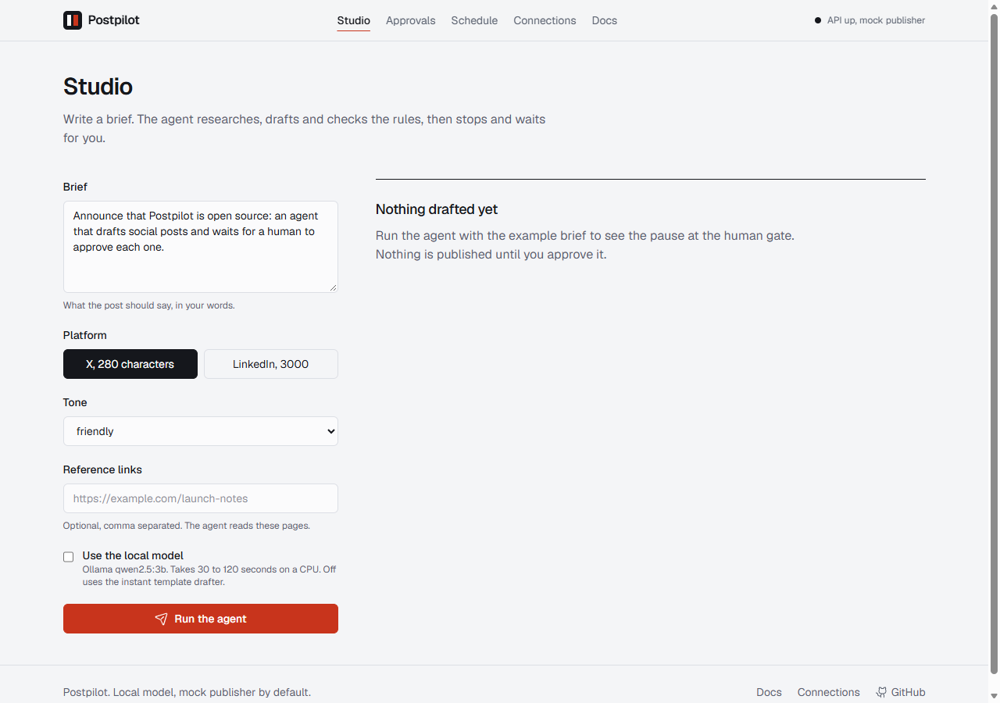
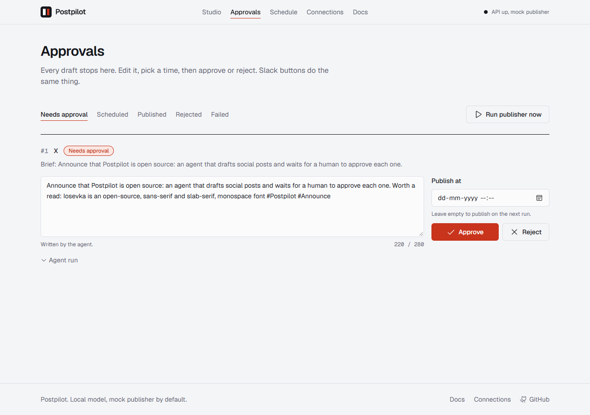

# Postpilot


An AI agent that researches a topic, drafts a post for X or LinkedIn, checks it against brand rules, and then **stops until a human approves it**. Approved posts are scheduled and published by a cron-driven worker. It runs on a free local model (Ollama), so there is no API bill.



## What it does

- **Generates** posts with a LangGraph workflow: research, draft, check, approval, schedule.
- **Reviews** every draft with deterministic rules next to the model: platform length, hashtag cap, banned phrases, near-duplicates.
- **Waits for a human.** The graph calls `interrupt()`, saves state to SQLite, and resumes only when someone approves, edits or rejects, from the web app or a signed Slack button.
- **Schedules and publishes** with APScheduler: a 30 second publish tick, plus cron campaigns that draft on a timetable (they never publish by themselves).
- **Calls tools:** `fetch_url`, `trending_topics`, `hashtag_suggest`, `char_limit`. The model picks tools; the code validates the choice.
- **Connects accounts** with OAuth 2 authorization code and PKCE; tokens are encrypted at rest.

| Studio | Approvals |
| --- | --- |
|  |  |

## Architecture

```
brief -> research (tools) -> draft (LLM or template) -> check (rules)
                                  ^                        |
                                  +---- violations --------+   up to 3 drafts, then safe trim
                                                           v
                              approval  <-- interrupt(), state in SQLite
                                  |   web UI / Slack button / CLI
                                  v
                      schedule -> scheduler tick -> publisher (mock | X | LinkedIn)
```

| Part | File |
| --- | --- |
| Workflow graph and interrupt | `backend/app/agent/graph.py` |
| Tools and planner | `backend/app/agent/tools.py` |
| Rules | `backend/app/rules.py` |
| Decisions, publishing, campaigns | `backend/app/service.py` |
| Slack signing and messages | `backend/app/slack.py` |
| OAuth and token storage | `backend/app/oauth.py` |
| Cron and publish tick | `backend/app/scheduler.py` |
| API | `backend/app/main.py` |

## Problems and how they are handled

| Problem | Handling | Test |
| --- | --- | --- |
| Draft longer than the platform limit (X counts links as 23 characters) | Rule check, feedback to the model, 3 tries, then trim. An over-limit draft cannot be approved. | `test_too_long_draft_is_revised_with_feedback`, `test_hard_violation_blocks_approval...` |
| Agent publishes without consent | Graph stops at `interrupt()`. Only a decision resumes it. | `test_graph_pauses_at_approval...` |
| Server restarts while a draft waits | Checkpoints live in SQLite. | `test_approval_survives_restart_and_schedules` |
| Double click, or Slack plus web, decides twice | Atomic `UPDATE ... WHERE status=` claim, second caller gets 409. | `test_second_decision_conflicts` |
| Two workers publish the same post | Same claim pattern on `scheduled` to `publishing`. | `test_publish_only_due_posts_and_only_once` |
| Publisher API fails | 3 attempts with growing delay, then `failed` with the error. | `test_failed_publish_retries_then_gives_up` |
| Forged or replayed Slack click | HMAC-SHA256 over `v0:{ts}:{body}`, 5 minute window, constant-time compare. | `test_signature_rules`, `test_slack_rejects_bad_signature...` |
| OAuth CSRF and code replay | PKCE S256, random `state`, single use, 10 minute TTL, bound to provider. | `test_callback_rejects_forged_expired...` |
| Stolen database | OAuth tokens are Fernet encrypted with a key derived from `POSTPILOT_SECRET_KEY`. | `test_callback_exchanges_code_once_and_encrypts_tokens` |
| Small model invents a URL to fetch | Only URLs the user supplied are fetched. | `test_plan_drops_urls_the_model_invented` |
| SSRF through `fetch_url` | Public addresses only, every resolved IP checked (NAT64 unwrapped), no redirects, 200 KB cap. | `test_ssrf_guard_*` |
| Model down or returns junk | Each step degrades alone: template drafter, default tool plan. | `test_model_failure_degrades_to_template` |
| Unauthenticated API | Bearer token on every `/api` route. | `test_health_is_open_but_everything_else_needs_a_token` |

## Run it

Needs Python 3.12 or newer, Node 22, and optionally [Ollama](https://ollama.com) with `qwen2.5:3b`.

```bash
# backend
cd backend
python -m venv .venv && .venv/Scripts/activate     # source .venv/bin/activate on Linux and macOS
pip install -r requirements.txt
python -m pytest -q                                # offline, no model needed
uvicorn app.main:app --port 8050

# frontend (second terminal)
cd frontend && npm install && npm run dev          # http://localhost:5190
```

Open the Studio, leave "Use the local model" off for an instant demo, run the agent, then approve in Approvals and press "Run publisher now". The mock publisher records a reference and touches no real account.

CLI, no server needed: `python -m app.cli draft "Announce our release" --platform x --no-llm`, then `python -m app.cli decide 1 approve` and `python -m app.cli publish-due`.

Docker: `cp .env.example .env && docker compose up --build`, then open http://localhost:8090.

## API

All `/api` routes need `Authorization: Bearer <POSTPILOT_TOKEN>` (default `pp-demo-token`, change it).

| Method | Path | Purpose |
| --- | --- | --- |
| GET | `/api/health` | Status, no token needed |
| POST | `/api/posts` | Run the agent on a brief |
| GET | `/api/posts?status=` | List posts |
| POST | `/api/posts/{id}/decision` | `approve`, `edit` or `reject` |
| POST | `/api/scheduler/tick` | Publish due posts now |
| GET, POST, DELETE | `/api/campaigns` | Cron campaigns |
| POST | `/api/campaigns/{id}/run` | Fire a campaign now |
| GET | `/api/oauth/{provider}/start` | Begin OAuth with PKCE |
| GET | `/api/oauth/{provider}/callback` | Provider redirect, authenticated by `state` |
| POST | `/slack/actions` | Slack button callback, signature verified |
| GET | `/api/audit` | Who did what |

## Verification status

Verified by running it:

- 46 backend tests pass offline (`FakeClient`, fake HTTP).
- Frontend production build succeeds; Landing, Studio, Approvals and Schedule pages were rendered and inspected in headless Edge.
- Real `qwen2.5:3b` through Ollama drafted a post that passed the rules (about 30 seconds on a CPU).
- Real RSS fetch through `trending_topics` over the network.
- HTTP flow end to end through the Vite proxy: create, approve, publish with the mock publisher, unsigned Slack request rejected with 401, and a correctly signed forged Slack button request approved a post on the running server (no real Slack involved).

**Not verified:**

- Real X and LinkedIn OAuth and posting. The adapters follow the public API documentation but have not run against live accounts, and endpoints or scopes may need adjusting.
- A live Slack workspace. Signing and parsing are unit tested; Slack needs a public URL for interactivity, so use a tunnel in development.
- Docker images and the GitHub Actions run.

## Limitations

- Single user, SQLite, one process. The in-process scheduler is not a distributed queue.
- A crash during a send leaves the post in `publishing`. That is deliberate: a stuck post is safer than a double post. There is no automatic recovery yet.
- The 3B model writes plain drafts. Quality rises with a larger model through `LLM_PROVIDER=openai`.
- The default `POSTPILOT_TOKEN` and `POSTPILOT_SECRET_KEY` are for local demos only.
- Template mode just echoes the brief with hashtags.

## Roadmap

Image attachments, reply drafting, per-account brand voices, recovery of stuck `publishing` posts, multi-user roles.

## License

MIT
